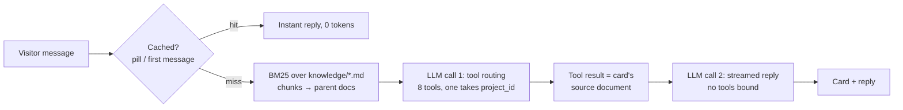

# Abhishek Yadav — AI Portfolio

**Live:** [yadavabhishekz.tech](https://yadavabhishekz.tech)

A personal portfolio where the whole experience is a chat. Visitors ask questions (or click a quick-question pill) and the AI answers in my voice, grounded in my real project write-ups, while opening an interactive card: projects, a single project's deep dive, skills, experience, resume, contact, or how the site itself works.

**Stack:** React · Vite · Tailwind CSS · FastAPI · LangChain · Groq (`gpt-oss-120b`) · BM25 retrieval

## How it works



1. **Retrieve** — `backend/knowledge/*.md` is split into chunks by heading and ranked with BM25. The best chunks are expanded to their whole parent document (small-to-big), so a question worded differently from the answer still gets every fact about that project.
2. **Route** — the LLM picks at most one tool. Tools are routing signals for UI cards; `getProject(project_id)` takes a typed enum, so naming a project opens its detail card.
3. **Ground** — the tool's result carries the document behind that card and is added to the reply call's system prompt, so the reply and the card state the same facts. The reply call has no tools bound: with `tool_choice="none"`, gpt-oss occasionally still emitted a tool call, which Groq rejects.
4. **Stream** — the reply streams token by token; the card renders immediately from static frontend data. The LLM never writes the card content.

### Design decisions

| Decision | Why |
|---|---|
| BM25 instead of embeddings | A local embedding model measured ~500 MB extra RAM and ~9 s cold start — too much for a 512 MB free tier. The corpus is small and keyword-heavy (project/model names). |
| Small-to-big retrieval | Fixes the keyword-vocabulary gap ("GPU" vs "memory") at the cost of a few hundred tokens. |
| Reply cache for history-free questions | Pills are most of the traffic; they cost zero tokens after the first visitor. Cached replies are always generated without history, so one visitor's conversation can't leak into everyone's answer. |
| Key rotation + model fallback | Requests rotate across Groq keys and fall through on 429/401/5xx, then retry on a fallback model (rate limits are per model). |
| Static cards, LLM only routes | Facts on screen can't be hallucinated. |

**Routing eval** (`backend/eval_routing.py`, 20 questions + 3 follow-ups): `gpt-oss-120b` routed **23/23** correctly across repeated runs (temperature 0 for routing). The fallback `gpt-oss-20b`, used only when every key is rate-limited, occasionally re-shows a card on a follow-up. Previous replies carry a `[Card shown: …]` marker so the model knows what's on screen.

## Project structure

```
backend/
  main.py            FastAPI app: /api/chat, cache, rate limiting, serves frontend/dist
  llm.py             Groq client pool: key rotation, fallbacks, fallback model
  retriever.py       BM25 retriever + small-to-big document expansion
  tools.py           8 LangChain tools (card routing + grounding documents)
  prompts.py         Persona, grounding rules, tool guide
  knowledge/*.md     Everything the chatbot knows about me (one file per topic)
  tests/             pytest suite (fake LLM — no network, no tokens)
  eval_routing.py    Live routing eval against Groq
frontend/
  src/data.js        Everything the cards show (keep in sync with knowledge/)
  src/App.jsx        Chat state, streaming, cards, stop button
  src/components/    Cards, ProjectDetail, HowItWorksCard, ChatInput, QuickQuestions
Dockerfile           Builds the frontend, runs FastAPI (one container)
render.yaml          Render Blueprint (free plan, Docker)
```

## Run locally

Requirements: Python 3.12, Node 18+, a free [Groq API key](https://console.groq.com/keys).

```bash
# Backend
cd backend
python -m venv venv
venv\Scripts\activate            # Windows  (macOS/Linux: source venv/bin/activate)
pip install -r requirements.txt
copy .env.example .env           # then put your key in GROQ_API_KEY
uvicorn main:app --reload --port 8000

# Frontend (second terminal) — proxies /api to :8000
cd frontend
npm install
npm run dev                      # http://localhost:5173
```

Production mode locally: `cd frontend && npm run build`, then run uvicorn and open http://localhost:8000.

## Tests

```bash
cd backend
pip install -r requirements-dev.txt
pytest -q                        # 25 tests, no network
python eval_routing.py           # live routing eval (uses Groq quota)
```

## Deploy (free tier)

The app is one container that fits comfortably in 512 MB (measured ~76 MB private memory at peak with pinned dependencies). Keep a single uvicorn worker.

**Render:** New → Blueprint → select this repo (`render.yaml` sets up a free Docker web service with a health check). Enter `GROQ_API_KEY` (and optionally `GROQ_API_KEYS`, comma-separated) when prompted.

**Railway / Koyeb / any container host:** deploy the repo; the `Dockerfile` is detected automatically and listens on `$PORT`. Set the same environment variables.

### Environment variables

| Variable | Required | Default | Purpose |
|---|---|---|---|
| `GROQ_API_KEY` | yes | — | Groq API key |
| `GROQ_API_KEYS` | no | — | Extra keys, comma-separated, used in rotation |
| `GROQ_MODEL` | no | `openai/gpt-oss-120b` | Chat model (Groq retires models — change here) |
| `GROQ_FALLBACK_MODEL` | no | `openai/gpt-oss-20b` | Tried after every key is rate-limited; empty disables |

Free hosting tiers sleep when idle, so the first visit after a quiet period takes ~30–60 s; the in-memory reply cache refills after each restart.

## Updating content

- Facts the chatbot uses: `backend/knowledge/*.md` (front matter: `title`, `source`; sections start with `## `).
- What the cards show: `frontend/src/data.js`.
- Adding a project: add it to both, plus its id to `ProjectId` in `backend/tools.py` — `tests/test_tools.py` fails if the ids drift apart.

## License

The **code** is released under the [MIT License](LICENSE) — feel free to learn from it or reuse it with attribution.

My **personal content** — photo, resume, project screenshots, and the text about me in `backend/knowledge/`, `frontend/src/data.js`, and `backend/prompts.py` — is **all rights reserved** and not covered by the MIT License. If you fork this project, please replace it with your own.
